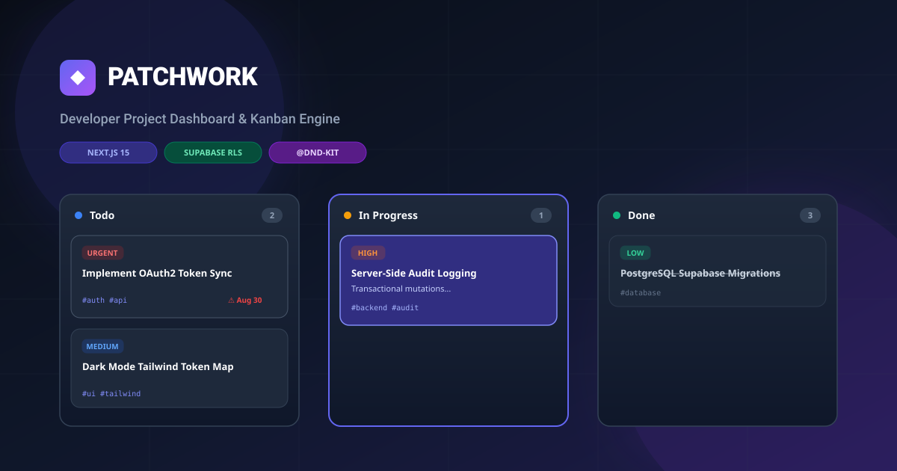

<div align="center">

# 🧩 PATCHWORK
### Production-Grade Developer Project Dashboard & Kanban Engine

[](https://www.npmjs.com/package/patchwork-dashboard)
[](https://nextjs.org/)
[](https://www.typescriptlang.org/)
[](https://supabase.com/)
[](https://tailwindcss.com/)
[](https://nodejs.org/)

<br/>



<br/>

**Patchwork** is a generic, high-reliability Developer Project Dashboard built for small development teams and solo builders.
<br/>
*Built with the core design philosophy: **Functionality > Reliability > UX > Visual Polish**.*

```bash
npx patchwork-dashboard init my-board
```

</div>

---

## 📑 Table of Contents
- [🚀 Install](#-install)
- [✨ Key Features](#-key-features)
- [🛡️ Security Architecture & Data Flow](#security-architecture)
- [🧱 Data Integrity & Atomicity](#-data-integrity--atomicity)
- [📊 Database Schema](#-database-schema)
- [⚡ Quick Start (Manual Setup)](#-quick-start-manual-setup)
- [🧪 Automated Test Suite](#-automated-test-suite)
- [📱 Responsive Design & Mobile Fallbacks](#-responsive-design--mobile-fallbacks)
- [🚢 Deploying to Vercel](#-deploying-to-vercel)
- [📬 Contact & Author](#-contact--author)

---

## 🚀 Install

The fastest way to get Patchwork running is the npm package:

```bash
# scaffold into ./my-board (also works with npx, no global install needed)
npx patchwork-dashboard init my-board

# or install globally
npm install -g patchwork-dashboard
patchwork-dashboard init my-board
```

The CLI copies the complete app, creates your `.env.local`, offers to run `npm install`, and prints the exact remaining steps (create a Supabase project → run the 2 migrations → paste your keys → `npm run dev`).

Prefer starting from the source instead? Use the [manual setup](#-quick-start-manual-setup) below.

---

## ✨ Key Features

### 1. 🗂️ Project Workspaces & Global Metrics
- Create, rename, edit, and delete isolated project workspaces.
- Real-time aggregate dashboard displaying total projects, active tasks, completion rate, and overdue task count.

### 2. 📋 Interactive Kanban Board (`@dnd-kit`)
- Multi-column drag-and-drop workflow powered by Next.js Server Actions with optimistic UI updates and instant rollback on failure.
- Accessible keyboard navigation and touch-optimized sensor configuration.

### 3. ⚙️ Dynamic & Configurable Status Columns
- Defaults to `Backlog` → `Todo` → `In Progress` → `Review` → `Done` on project creation.
- Add new custom status columns, pick custom palette colors, rename, and delete columns.
- **Zero-Orphan Deletion**: Deleting a status column safely moves its tasks to the fallback column automatically — atomically.

### 4. 🚨 Reliable Server-Side Overdue Engine
- Overdue status is computed deterministically on the server: `due_date < current_date` AND status is not `Done` (or the project's final column).
- Highlighted across Kanban cards, metrics, and project overviews with high-visibility red badges.

### 5. 🔍 Fast Combinable Search & Multi-Filters
- Live filtering matching title substring and `#tags`.
- Combine filters by: **Status**, **Priority** (`low`, `medium`, `high`, `urgent`), **Assignee**, **Tag**, and **"Overdue Only"**.

### 6. 📜 Audit-Grade Activity Logging
- Every field mutation (status change, title edit, priority bump, assignee update, due date shift) is automatically logged **inside the same database transaction** as the change itself.
- View task history directly inside the task detail modal or inspect the project-wide audit timeline.

### 7. 📝 Project Scratchpad & Notes
- Free-text timestamped scratchpad attached to each project for storing architecture decisions, snippets, and deployment logs.

### 8. 🌓 Dark Mode & Mobile Usability
- Seamless Dark/Light mode toggle with CSS custom properties.
- Responsive mobile fallback: Status dropdown selector for 1-tap card transitions on touch screens.

---

<a id="security-architecture"></a>

## 🛡️ Security Architecture & Data Flow

```
┌─────────────────────────────────────────────────────────────┐
│                    Browser / Client UI                      │
│      (Zero Secrets, No Service Role Key, No Direct Fetch)   │
└──────────────────────────────┬──────────────────────────────┘
                               │
                      Next.js Server Actions
                 ('use server' RPC invocation)
                               │
                               ▼
┌─────────────────────────────────────────────────────────────┐
│                   Next.js Server Runtime                    │
│  • Server Actions (app/actions/*.ts)                        │
│  • Server-side validation (lib/validate.js)                 │
│  • Atomic mutations via Postgres RPC (lib/db.ts)            │
│  • Automatic activity logging (same transaction)            │
│  • Service Role Supabase Client (lib/supabase.ts)           │
└──────────────────────────────┬──────────────────────────────┘
                               │
                 Internal Postgres Connection (Bypasses RLS)
                               │
                               ▼
┌─────────────────────────────────────────────────────────────┐
│                   Supabase (PostgreSQL)                     │
│  • RLS Enabled on ALL tables (Public/Anon Denied)           │
│  • Atomic plpgsql functions (single-transaction mutations)  │
│  • Foreign Keys & Cascade Deletions                         │
│  • Unique Order Constraints & High-Speed Indexes            │
└─────────────────────────────────────────────────────────────┘
```

Direct browser-to-`/api/*` calls are **not** part of the normal application flow — the UI talks exclusively to Server Actions.

### Security Guarantees

1. **Zero Browser Secret Exposure**
   - `SUPABASE_SERVICE_ROLE_KEY` and `PATCHWORK_API_SECRET` are never exposed to the client or bundled into client JavaScript.
   - All client interactions invoke Next.js **Server Actions** directly (`app/actions/*`).
2. **External Integration API Surface (`/app/api/*`)** — optional, for non-browser tools/scripts only
   - Protected by a single shared `requireApiSecret` helper (`lib/auth.ts`) checking `PATCHWORK_API_SECRET` (`Authorization: Bearer <secret>` or `x-patchwork-api-key: <secret>`) on **every** route (projects, tasks, statuses, notes, activity, and their `[id]` variants).
   - **Fail-closed by design**: if `PATCHWORK_API_SECRET` is not configured, the helper logs a server-side error and rejects every request with `500 Server Configuration Error` — the external surface is disabled entirely, never left open. A missing secret can never open the API.
3. **Database-Level Protection**
   - Row-Level Security (RLS) is enabled on all tables, denying anonymous/public access at the Postgres engine level.

---

## 🧱 Data Integrity & Atomicity

Because every Supabase JS call is an independent HTTP request (no client-side transactions), all multi-step mutations run as **single Postgres transactions** via plpgsql RPC functions (`supabase/migrations/20260829120000_atomic_rpc.sql`):

| Operation | Atomic function | Rolled back together |
|---|---|---|
| Create project | `create_project_with_statuses` | project insert + 5 default statuses seed |
| Create task | `create_task_atomic` | task insert + tag upsert/link + activity log + project bump |
| Update task | `update_task_atomic` | field updates + tag resync + per-field activity rows |
| Delete task | `delete_task_atomic` | activity log + delete + project bump |
| Reorder statuses | `reorder_statuses` | two-phase reindex (park at 10000+ offset, then 0..n-1) |
| Delete status | `delete_status_atomic` | task reassignment to fallback + delete + reindex |
| Create note | `create_note_atomic` | note insert + project bump |

A failure partway through any operation rolls back **everything** — no partial or orphaned data is ever committed. Cross-project `status_id` references and invalid priorities are rejected *inside* the transaction (defense in depth), in addition to the Server Action validation layer.

---

## 📊 Database Schema

Managed exclusively via Supabase migrations (run **both**, in order — see [setup](#-quick-start-manual-setup)):

```sql
-- Core Tables
projects   (id uuid PK, name text, description text, created_at, updated_at)
statuses   (id uuid PK, project_id FK, name text, order_index int, color text, UNIQUE(project_id, order_index))
tasks      (id uuid PK, project_id FK, title text, description text, status_id FK, priority check, assignee text, due_date date)
tags       (id uuid PK, name text UNIQUE)
task_tags  (task_id FK, tag_id FK, PK(task_id, tag_id))
activity   (id uuid PK, task_id FK, project_id FK, field text, old_value text, new_value text, description text)
notes      (id uuid PK, project_id FK, content text, created_at)
```

Full column-by-column documentation: [SCHEMA.md](./SCHEMA.md).

---

## ⚡ Quick Start (Manual Setup)

### 1. Clone the repository
```bash
git clone https://github.com/v01dst/patchwork.git
cd patchwork
```

### 2. Configure Environment Variables
Copy `.env.example` to `.env.local`:
```bash
cp .env.example .env.local
```
Fill in your Supabase credentials:
```env
NEXT_PUBLIC_SUPABASE_URL=https://your-project.supabase.co
NEXT_PUBLIC_SUPABASE_ANON_KEY=your-anon-key
SUPABASE_SERVICE_ROLE_KEY=your-service-role-key
PATCHWORK_API_SECRET=your-external-api-secret
```

> ⚠️ **`PATCHWORK_API_SECRET` is REQUIRED for the optional external `/api/*` surface to function at all** — not just recommended. If it is omitted, every `/api/*` route handler **rejects all requests with a `500 Server Configuration Error`** (fail-closed). Omitting it intentionally *disables* the external API surface entirely — it never silently opens it. The app's own UI is unaffected: it communicates via Next.js **Server Actions**, not `/api/*`.

### 3. Run Database Migrations
In the Supabase dashboard, open the **SQL Editor** and run both migration files **in order**:

```
supabase/migrations/20260829000000_init_patchwork.sql   # tables, indexes, RLS
supabase/migrations/20260829120000_atomic_rpc.sql       # atomic transaction functions (REQUIRED)
```

The second migration is **mandatory** — it creates the atomic RPC functions the app calls for every mutation.

Or, with the Supabase CLI:
```bash
supabase db push
```

### 4. Install Dependencies & Start Dev Server
```bash
npm install
npm run dev
```
Open [http://localhost:3000](http://localhost:3000) in your browser.

---

## 🧪 Automated Test Suite

35 tests across 6 suites, runnable with zero dependencies (Node's built-in test runner):

```bash
npm test
```

| Suite | Tests | Covers |
|---|---|---|
| Server Actions Data Flow & Validation | 3 | status moves without fetch, activity logging, typed error results |
| Activity Diff Calculation Logic | 3 | per-field audit entries, multi-field changes, no-op detection |
| API Secret Auth is FAIL-CLOSED | 6 | unset secret → 500 `authorized:false` (not 200), empty-string secret, wrong key → 401, correct key → 200 |
| Server-Side Overdue Computation | 5 | no due date, Done/final-status exceptions, past/future dates |
| QA Reliability Suite | 10 | atomic project+statuses seed, atomic task+tags+activity, status deletion with reassignment, reorder rollback under simulated failure, cross-project ID rejection, simulated DB failure leaving no partial data, tag normalization |
| Validation Rules & Enums | 2 | priority enums, date parsing |

```
# tests 35
# pass 35
# fail 0
```

---

## 📱 Responsive Design & Mobile Fallbacks

- **Desktop**: Drag and drop cards freely across status columns with `@dnd-kit`.
- **Mobile (< 640px)**: Cards feature a dedicated 1-touch status picker dropdown allowing seamless movement across workflow stages on touch devices without needing precise multi-column drags.

---

## 🚢 Deploying to Vercel

1. Push your scaffolded copy to GitHub.
2. Import the repository into [Vercel](https://vercel.com) (framework preset: Next.js).
3. Add the environment variables (`NEXT_PUBLIC_SUPABASE_URL`, `NEXT_PUBLIC_SUPABASE_ANON_KEY`, `SUPABASE_SERVICE_ROLE_KEY`, and optionally `PATCHWORK_API_SECRET`) in the **Vercel dashboard** — never commit real values to the repository.

---

## 📬 Contact & Author

- **Discord**: `9p.1`
- **GitHub**: [@v01dst](https://github.com/v01dst)
- **npm**: [patchwork-dashboard](https://www.npmjs.com/package/patchwork-dashboard)
- **License**: MIT
